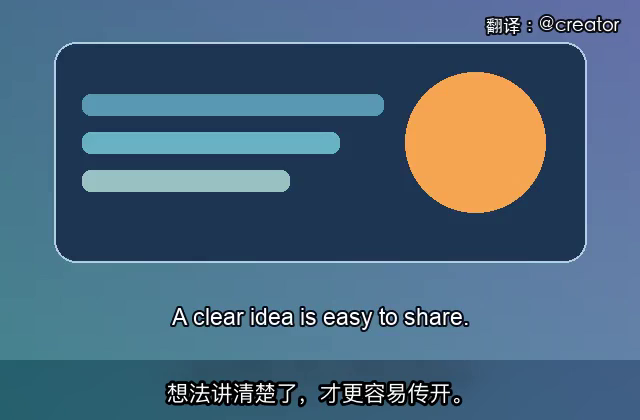

# X 视频译制与发帖

**主打翻译后的原创感处理：**把用户提供的英文视频译制成更像自己制作的中文发布版，降低一眼搬运的观感。流程包括核对原话、自然译写、保留已有英文字幕并重排中文、设计准确的开场钩子、调整节奏与署名，最后交付成片、同步 SRT 和可修改的 X 帖文草稿。翻译与事实核查由 Codex 结合素材完成，脚本负责转录草稿、渲染、校验和记录。本技能采用 MIT 许可；个人偏好与任务台账保存在仓库外。

这里的「逼近原创」指译制表达和成片观感。X 对原创内容另有实质性要求；镜像、滤镜、调速、叠字或更改文件指纹本身不会使他人的视频获得原创资格。见 [X 原创内容规则](https://help.x.com/en/using-x/original-content-rewards)。

不把“听不见的音轨”或“看不见的蒙层”当作常规去重功能：这类对抗扰动只可能针对特定识别模型有效，上传转码后也未必保留，更不能证明内容原创。制作时优先保证音画清晰、译文准确与来源透明。

**先看案例：**[真实任务记录](examples/马斯克访谈案例.md) · [播放原创演示短片](examples/layout-demo.mp4) · [同步字幕示例](examples/layout-demo.srt) · [English guide](README.en.md)



演示短片的图形、台词和合成语音均为本仓库制作，仅用于展示排版、署名和 1.2 倍速；真实任务的译写与处理决定见上方案例。

## 1. 从零安装

需要 Codex、Python 3.10+、带 `subtitles`/libass 滤镜的 FFmpeg 和中文字体。macOS/Linux 按下列步骤操作；Windows 建议使用 WSL。

```bash
git clone https://github.com/Balance0014/video-translation-x-post.git ~/.codex/skills/video-translation-x-post
cd ~/.codex/skills/video-translation-x-post
python3 -m venv .venv
source .venv/bin/activate
python -m pip install -r requirements.txt
python scripts/self_test.py
```

如果设置了 `$CODEX_HOME`，请把仓库放进 `$CODEX_HOME/skills/`。重新载入 Codex 后调用 `$video-translation-x-post`。自检会制作合成短片，检查双语与纯中文布局、1.2 倍速、音视频解码和字幕时间轴；不会发帖，也不会下载语音模型。缺 FFmpeg 或中文字体时，先通过系统包管理器安装，再重新自检。

## 2. 给 Codex 一段视频

附上视频或绝对路径，并复制这段需求，替换路径与署名：

> 用 `$video-translation-x-post` 处理 `/absolute/path/input.mp4`，做成有独立译制感的中文 X 发布版。翻译成母语级中文；有英文字幕就保留，中文放在下面，没有英文就只放中文。设计准确的开场钩子与节奏，不挡人物、图表，不要大黑条。加 `翻译：@yourhandle` 水印。检查 1.2 倍速是否顺畅，必要时降速。先看短样片，再把视频、同步 SRT 和准确但有抓力的 X 文案交付桌面。不要代发，也不要宣称已获平台原创认定。

Codex 应先检查开头、中段、结尾，辨别英文字幕是画面内已有、独立字幕轨还是不存在，再核对原话、翻译、短样片和完整导出。

X 发布版默认在开头用约 2–3 秒点明原片最值得看的观点；如果原片开头已经清楚点题，或用户明确不要，则省略。钩子必须忠于原话，样片中要检查它没有盖住人物、原字幕、标志或署名。

## 3. 转录与翻译

优先使用可核对的原字幕或逐字稿。若有独立英文字幕轨，先确认流编号，再按实际编号提取。例如第一条字幕轨：

```bash
mkdir -p work
ffmpeg -i input.mp4 -map 0:s:0 work/english.srt
```

若没有可靠文本，可用本地工具制作**英文草稿**：

```bash
python scripts/transcribe.py --input input.mp4 --output work/english-draft.srt --language en --model base.en
```

首次转录可能下载语音模型，也可指定本地模型目录。让 Codex 对照声音和画面核查姓名、数字、观点与被截断的句子，再写 `work/chinese.srt`。转录草稿不是最终翻译；中文要自然，同时忠于原意，不把预测写成事实。

## 4. 短样片与正式导出

画面里已有英文字幕时用 `bilingual`；英文仅在独立 SRT 中时，再加 `--english-subtitles work/english.srt`。没有英文时用 `chinese-only`。

```bash
python scripts/render.py --input input.mp4 --subtitles work/chinese.srt \
  --output work/sample.mp4 --layout bilingual --watermark '翻译：@yourhandle' \
  --title '准确的开场钩子|一句话说明主题' --speed 1.2 --sample-seconds 8
```

播放样片，检查双语顺序、可读性、人物和图表、水印、标题、声音与镜头。双语模式会在原画面下方做柔和延展区放中文，不用大黑条。长句放不下时先精简字幕。

```bash
python scripts/render.py --input input.mp4 --subtitles work/chinese.srt \
  --output work/final.mp4 --layout bilingual --watermark '翻译：@yourhandle' \
  --title '准确的开场钩子|一句话说明主题' --speed 1.2
python scripts/verify.py --output work/final.mp4 --source input.mp4 --speed 1.2
```

成片旁自动生成 `work/final.srt`，时间轴已按最终速度重排。没有英文对白字幕时通常改用 `chinese-only`；如果原片底部有姓名标签或关键画面，也可用 `bilingual` 的柔和延展区保护原画面，但不要额外渲染英文字幕。水印与原片右上标志冲突时加 `--watermark-position top-left`。只有确认画面没有会倒置的文字、字幕、图表或 logo，才同时加入 `--mirror --mirror-verified`；双语模式禁止镜像。固定输出帧率下提速会自然减少部分帧，无须强行删帧。

## 5. 交付、发帖草稿与台账

```bash
cp work/final.mp4 ~/Desktop/final.mp4
cp work/final.srt ~/Desktop/final.srt
python scripts/verify.py --output work/final.mp4 --source input.mp4 --speed 1.2 \
  --delivered ~/Desktop/final.mp4
```

X 文案先用具体信息抓住注意力，再写观众能得到什么；涉及预测就标成预测，知道来源就注明。署名、改色、镜像、抽帧或 MD5 变化本身不代表原视频具备原创资格，具体看 [X 当前规则](https://help.x.com/en/using-x/original-content-rewards)。未经用户授权，不代发。

首次运行 `python scripts/state.py init`，命令会打印私有偏好和台账路径。每次完成任务，把真实素材路径、交付路径、处理选择、验收结果和经验写入 Markdown，再运行：

```bash
python scripts/state.py record --entry-file work/ledger-entry.md
```

## 常见问题

| 情况 | 处理 |
| --- | --- |
| 原片没有英文，却用了双语布局 | 通常改用 `--layout chinese-only`；若底部有姓名标签或关键画面，可以保留柔和延展区。 |
| 中英重叠或长句放不下 | 缩短字幕，重看短样片，再调布局。 |
| 缺中文字体 | 传入 `--font-file /path/to/CJK-font.ttf`，必要时加 `--font-name`。 |
| 1.2 倍速听着太赶 | 降低 `--speed`，重新核对时间轴。 |
| 镜像后文字反了 | 去掉 `--mirror`。 |
| 比例异常或交付文件损坏 | 重渲染、运行 `verify.py` 并核对交付副本。 |
